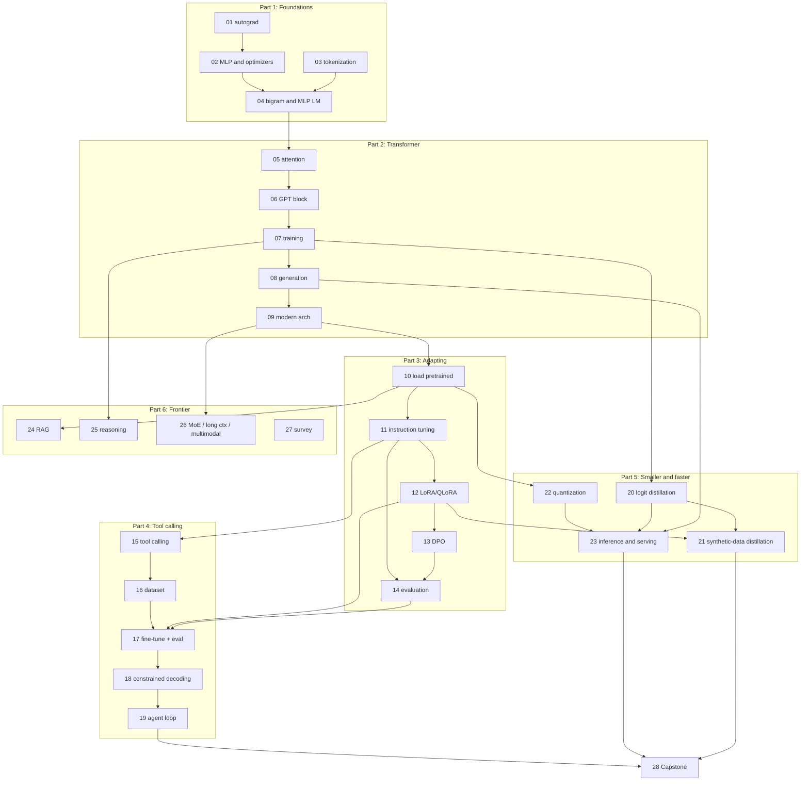

# llm-from-scratch-to-frontier

A hands-on course that takes you from "what is a tensor?" to building, training, adapting,
compressing, and serving language models with tool calling. You read a short explanation,
run real code, change it, and see what happens.

Every concept is built from scratch in plain PyTorch **before** the equivalent library is
used. By the end you will have written (and understood) every piece of a small but complete
LLM stack: tokenizer, transformer, trainer, sampler, LoRA, DPO, constrained decoding, an
agent loop, distillation, quantization, and a server.

> **Status:** planning. The lesson plan is in [PLAN.md](PLAN.md). Lessons are added in
> order. The table below shows what exists so far.

## Roadmap

| #  | Lesson | Part | Status |
|----|--------|------|--------|
| 01 | Tensors, autograd, and a tiny autograd engine | Foundations | planned |
| 02 | Neural network basics: MLP, loss, backprop, SGD to AdamW | Foundations | planned |
| 03 | Tokenization: characters, BPE from scratch, production tokenizers | Foundations | planned |
| 04 | Language modeling basics: bigram and MLP language models | Foundations | planned |
| 05 | Attention from scratch | Transformer | planned |
| 06 | The full GPT block | Transformer | planned |
| 07 | Training a GPT | Transformer | planned |
| 08 | Generation and KV caching | Transformer | planned |
| 09 | Modern architecture upgrades (RoPE, RMSNorm, SwiGLU, GQA, tying) | Transformer | planned |
| 10 | Loading pretrained weights into our own code | Adapting | planned |
| 11 | Full fine-tuning and instruction tuning | Adapting | planned |
| 12 | LoRA from scratch, QLoRA, and PEFT | Adapting | planned |
| 13 | Preference tuning: RLHF ideas and DPO | Adapting | planned |
| 14 | Evaluation | Adapting | planned |
| 15 | How tool calling works | Tool calling | planned |
| 16 | Building a tool-calling dataset | Tool calling | planned |
| 17 | Fine-tuning for tool calling, with an eval harness | Tool calling | planned |
| 18 | Constrained decoding (JSON schema) from scratch | Tool calling | planned |
| 19 | A minimal agent loop with real tools | Tool calling | planned |
| 20 | Knowledge distillation (logits) | Smaller & faster | planned |
| 21 | Distillation through synthetic data | Smaller & faster | planned |
| 22 | Quantization: 8-bit and 4-bit from scratch, GGUF | Smaller & faster | planned |
| 23 | Inference efficiency: batching, speculative decoding, serving | Smaller & faster | planned |
| 24 | Retrieval-augmented generation | Frontier | planned |
| 25 | Reasoning and thinking tokens | Frontier | planned |
| 26 | Mixture of experts, long context, multimodal | Frontier | planned |
| 27 | Survey of current developments | Frontier | planned |
| 28 | Capstone: pretrain → instruct → tools → distill → quantize → serve | Capstone | planned |

## How the lessons depend on each other

Arrows mean "uses code or a trained artifact from". Everything also builds on the shared
`core/` package, which grows as you go.



## Prerequisites

- Comfortable writing Python (functions, classes, list/dict comprehensions).
- High-school calculus (what a derivative is, the chain rule) and basic linear algebra
  (vectors, matrix multiplication). Each lesson has a short refresher where it needs math.
- No prior deep learning experience is assumed.

## Setup

> The `pyproject.toml` lands with Lesson 01. These are the commands it will support.

Python 3.12 or newer. Using [uv](https://docs.astral.sh/uv/) (recommended):

```bash
uv venv --python 3.12
source .venv/bin/activate
uv pip install -e ".[dev]"            # Parts 1-2: torch, numpy, tiktoken, matplotlib, pytest
uv pip install -e ".[dev,adapt]"      # Part 3 onward adds transformers, datasets, peft, ...
```

Or with plain pip: `python -m venv .venv && source .venv/bin/activate && pip install -e ".[dev]"`.

Download data with the scripts in `data/` (nothing large is committed):

```bash
python data/download_tinyshakespeare.py
python data/download_tinystories.py
```

## Running a lesson

```bash
cd lessons/07-training-a-gpt
python train.py --quick      # ~1 minute smoke test: proves everything runs
python train.py              # the real run, sized to finish in under ~30 minutes
```

Every script:

- auto-selects a device (`cuda`, then `mps`, then `cpu`); override with `--device`;
- writes outputs to `runs/<lesson>/` and shared trained models to `artifacts/` (both
  git-ignored), so later lessons can reuse earlier results;
- prints exactly what it is doing and what you should expect to see.

Each lesson README records the **actual** output from a real run (loss values, sample
generations, timings) and the machine it ran on, so you can compare.

## Repository layout

```
README.md            this file: roadmap, setup, dependency graph
PLAN.md              per-lesson goals, model/dataset sizes, expected runtimes
pyproject.toml       single, pinned dependency list (extras per course part)
core/                reusable code that grows lesson by lesson
lessons/NN-name/     README.md, runnable *.py scripts, exercises.md, solutions/
tests/               unit tests for core/ and a --quick smoke test per lesson
data/                download scripts only
GLOSSARY.md          terms, defined where they are first used
FURTHER_READING.md   papers and resources, per lesson
```

## Running the tests

```bash
pytest tests/core          # fast unit tests for core/
pytest tests/lessons       # runs every lesson script with --quick
pytest -m "not network"    # skip anything that needs to download models or data
```
